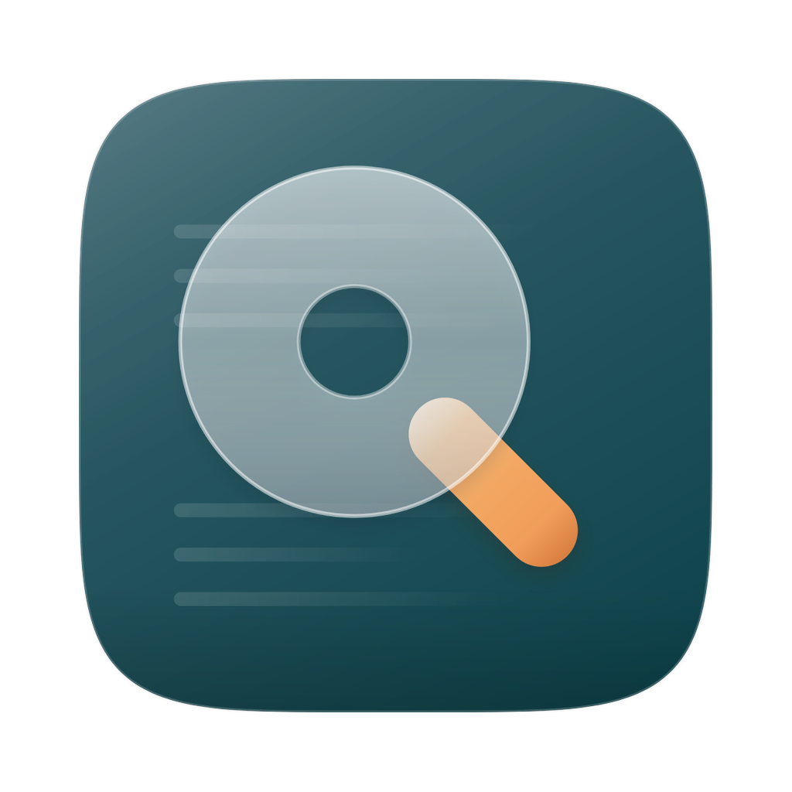

<div align="center">



# Looking Glass

**A local AI research companion for macOS.**
Native SwiftUI on the surface, a Python agent underneath, and everything runs on your own machine.

[](https://github.com/yogiee/LookingGlass/releases/latest)


</div>

---

Looking Glass is a chat app built around **Alice** — a research companion who's direct, curious, and actually in it with you, not a cheerful service desk. It talks to a local [Ollama](https://ollama.com) model, runs tools on your behalf, and keeps your conversations on disk where they belong. No cloud, no accounts, no telemetry.

It's a two-process app: a native SwiftUI window owns the experience, and a local Python sidecar owns the intelligence (the agent loop, tool execution, and inference calls). They talk over `localhost` via HTTP + server-sent events.

## Features

- **Streaming chat** with a **Liquid Glass** window that follows System Settings (or the classic Frosted look) — rail + collapsible sidebar, light/dark, Wonderland character avatars
- **A title bar for every chat** — a floating pill with the chat's title and a one-line summary written on your Mac (hover for all of it), the project's colour and name for project chats, delete, and **⌘F search inside the chat** with highlighted matches
- **A pill-shaped message box** — one line with mic and send; **+** opens attachments, formatting, the model and Deep Research
- **Voice** — talk to Alice in voice mode (hold Space, release to send) and hear her answer. Pick a voice in **Settings → Voice**: **LIGHT** (Kokoro, fast, on the CPU) or Alice's own cloned voice in **QUALITY / QUALITY+** (Qwen3-TTS on MLX). Voices and their engine download on request; reading speed changes live
- **Conversation history** that persists across launches (SQLite + full-text search), with **folder-bound Projects** alongside independent chats — rename, delete, search, organize
- **Built-in tools** — file read/write, shell, web search, HTTP, calculator, PDF extract, page reader, vision, memory, and a thinking scratchpad — run through a multi-turn agent loop with inline tool-call cards
- **Image generation and editing on your Mac** — ask Alice for a picture and she draws it with **FLUX.2 [klein]** on Apple's Core AI, then edits the same image when you ask for changes. Shown **inline** with a full-window viewer (zoom, pan, crop, copy, reveal in Finder) and a **4× upscaler** built on Apple's super-resolution
- **Alice sees your images** — share a screenshot or photo and she looks at it directly; text-heavy images are read with on-device OCR
- **MCP server support** — plug in [Model Context Protocol](https://modelcontextprotocol.io) servers (image generation, memory banks, your own tools) from **Settings → MCP**; their tools appear to Alice automatically
- **Organized file saving** — images, documents, and downloads Alice creates land in tidy type-folders under a save location you choose (**Settings → System → Files**), or the project folder when you're in a Project
- **Per-chat model switching** — change the model for one chat from the input bar without touching your global default; cloud "specialist" models are an explicit, consent-gated tap
- **GitHub-flavored markdown** rendering — headings, blockquotes, tables, task lists, code blocks
- **Big documents stay smooth** — when Alice writes a report, her commentary streams in the bubble while a live "Composing document…" counter tracks the rest; the finished document lands as a compact card that opens in a dedicated **report viewer** with its own WebKit rendering engine, so even giant table-heavy documents open fast and scroll smoothly
- **A clear "working" state** — while a turn runs, the message box locks (only Stop stays active) and a soft light laps its border, so long tool-call stretches never look stalled
- **Selectable chat font** — a sans for prose paired with a matching monospace for code (SF Pro, Inter, IBM Plex Sans, Roboto)
- **System panel** — CPU, GPU, Neural Engine and memory, with what's loaded in Ollama and what Looking Glass runs itself (Core AI and MLX models)
- **Configurable** — Ollama URL, per-tool toggles, MCP servers, save location, custom avatar, font size, line height, and Alice's system prompt, all in Settings
- **Auto-updates** via [Sparkle](https://sparkle-project.org)

## Requirements

- **macOS 27+** on **Apple Silicon**
- [Ollama](https://ollama.com) installed and running (`ollama serve` — the official app, not the Homebrew bottle)
- To build from source: [Homebrew](https://brew.sh) Python 3.14 (the app embeds its own venv, built from the Homebrew interpreter)

## Install

1. Install [Ollama](https://ollama.com) and make sure it's running.
2. Pull the models you want to use (see [Models](#models) below).
3. Download the latest `LookingGlass.dmg` from the [**Releases**](https://github.com/yogiee/LookingGlass/releases/latest) page, drag it to Applications, and launch.

The app starts and health-checks its sidecar automatically; updates arrive in-app via Sparkle. Models, MCP servers, and your save location are all configurable in **Settings**. The image model (4.3 GB, **Settings → System → Images**) and the voices (**Settings → Voice**) are optional downloads, so the app itself stays small.

## Models

Looking Glass resolves a model per **role**. The current default is deliberately simple — one capable, tool-native model handles chat, coding, and research, calling tools directly — with cloud models reserved for explicit, consent-gated taps. Configure roles in `sidecar/config.toml` (`[models]`) or pick per-chat in the app.

The current defaults:

| Role | Model | Pull |
|------|-------|------|
| Chat / coding / research | `gemma4:26b-mlx` | `ollama pull gemma4:26b-mlx` |
| Specialist (consult, cloud) | `gemma4:31b-cloud` | `ollama pull gemma4:31b-cloud` |
| Deep research (cloud) | `gpt-oss:120b-cloud` | `ollama pull gpt-oss:120b-cloud` |

Prefer a small, characterful chat model that can't call tools itself? That works too: pick it as the chat model and a separate **tool-capable "hands" model** (the `hands` role) runs tools behind the scenes while the voice model presents the result.

Use any chat-capable model you like — anything installed shows up in the picker. If the configured model isn't installed, the app falls back to one that is and tells you. Cloud models (`*-cloud`) run on Ollama's servers and are only ever used on an explicit tap.

> **Note:** model recommendations are based on current testing and daily usage on an **Apple M1 Max (10-core CPU / 32-core GPU) + 32 GB RAM** system. Pick models that fit your own hardware.

## Image generation

Alice draws and edits images with **FLUX.2 [klein] 4B** (Apache-2.0, Black Forest Labs), converted for Core AI and run by a small helper bundled with the app. Download the model once from **Settings → System → Images**. A new image takes about 25 seconds on an M1 Max and an edit about a minute; if memory is tight, the app briefly unloads the voice and then the chat model to make room, and Alice picks up right after.

## Local tools (OllamaMCP)

Extra local model tools (vision, OCR, code, embeddings) are available from the optional **[OllamaMCP](https://github.com/yogiee/ollama-mcp)** server — local Ollama models exposed as MCP tools, all on-device. Set it up from its repo, then add it in **Settings → MCP**; its tools become available to Alice automatically.

## Build from source

```bash
# Run in development (bare executable, sidecar auto-launched)
swift run

# Or build a distributable .app with an embedded sidecar venv
./scripts/build-app.sh debug      # → build/LookingGlass.app
./scripts/build-app.sh release    # → build/LookingGlass.app + signed DMG
```

The sidecar can also run on its own:

```bash
cd sidecar && pip install -r requirements.txt && python main.py
curl http://localhost:8765/health
```

## Architecture

```
SwiftUI App  ──HTTP + SSE (localhost:8765)──▶  Python Sidecar (FastAPI)
   renders                                        ├─▶ Ollama (inference)
   never runs tools                               └─▶ Tool router → builtin tools + MCP
```

Swift owns the surface — rendering, history, configuration. The sidecar owns the intelligence — the agent loop, tool routing, and prompt composition. Adding a tool needs no Swift changes: drop a module in `sidecar/tools/builtin/` and restart.

## Alice

A system prompt is prepended to every conversation — never bypassed. The repo ships a generic research-companion Alice (`sidecar/prompts/alice.md`); set your own in **Settings → Personality → System Prompt** and it's used instead, stored locally.

---

<div align="center">
<sub>A personal project, shared in the open. Built for daily use on a Mac.</sub>
</div>
